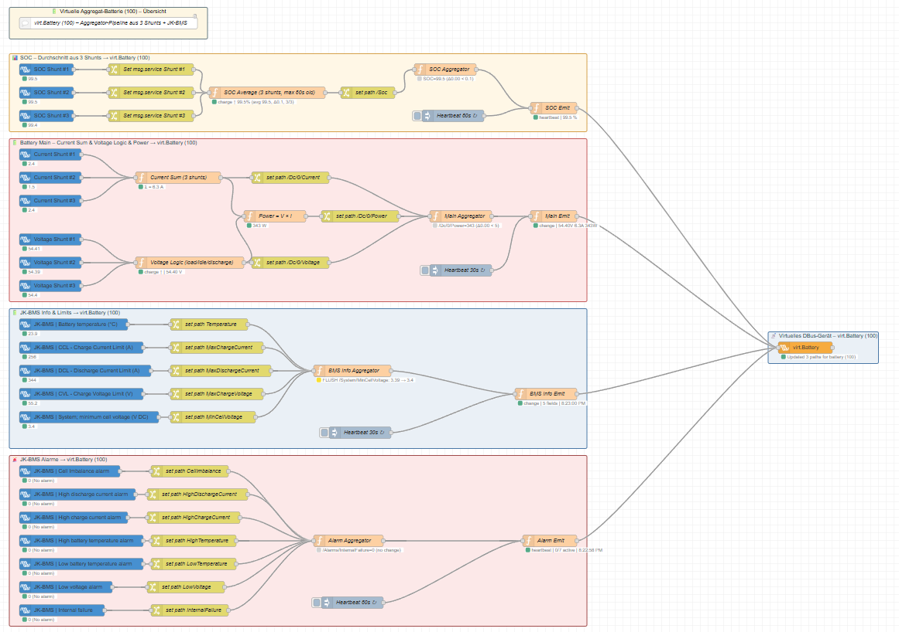

# Victron Node-RED – Virtual Battery

A Node-RED flow for Victron GX devices that creates a virtual battery (`com.victronenergy.battery/100`) on the D-Bus — without any scripts, fully transparent and editable inside Node-RED.

---

## Background & Motivation

The JK-BMS provides current, power, and SOC readings, but their accuracy is limited compared to a dedicated shunt-based measurement. The SOC in particular tends to drift over time and is less reliable than a coulomb-counting SmartShunt. The goal of this project was to **replace the JK-BMS current, power, and SOC data with values from SmartShunts** — while still using the BMS for what it does best: protection limits (CCL, DCL, CVL), cell voltages, temperature, and alarms.

The concrete setup uses **3 parallel SmartShunts** (one per string) aggregated into a single virtual battery. The aggregation logic (SOC averaging, voltage selection, current summing) is specific to this installation, but the **virtual battery pattern itself is generic** and can be adapted to any setup with one or more shunts and a BMS.

Everything runs in Node-RED with standard nodes — no shell scripts, no Python, no custom services. The full logic is always visible, inspectable, and modifiable in the flow editor.

---

## D-Bus Performance Considerations

D-Bus read and write operations on a Victron GX device are not free. Frequent writes — especially unconditional ones — can noticeably affect system performance on constrained hardware like the Cerbo GX.

This flow addresses that with two complementary patterns:

- **Change-only / Deadband filtering:** Values are only forwarded to the virtual device if they have changed by more than a defined threshold (e.g. ≥ 0.1 A, ≥ 0.01 V, ≥ 5 W). Noise and tiny fluctuations are swallowed.
- **Heartbeat keep-alive:** Because change-only alone means a value might never arrive at the virtual device if nothing changes (e.g. after a Node-RED restart), each subsystem has a periodic heartbeat (30 s or 60 s) that flushes the last known snapshot regardless of changes.

**Multi-value payloads** are used throughout: instead of one D-Bus write per path, a single payload object containing all paths is sent to the `victron-virtual` node per flush.

---

## How It Works

### Aggregation Logic

| D-Bus Path | Calculation |
|------------|-------------|
| `/Soc` | Average of 3 shunts (stale filter 600 s); Soft-Min during discharge |
| `/Dc/0/Current` | Sum of all 3 shunts |
| `/Dc/0/Voltage` | ≥ 51.7 V → Max (overcharge protection); < 51.7 V → Min (deep discharge protection); rate limiter max 0.03 V/cycle |
| `/Dc/0/Power` | `virt_voltage × virt_current` |
| `/Dc/0/Temperature` | Direct from JK-BMS |
| `/Info/MaxChargeCurrent` | Direct from JK-BMS (CCL) |
| `/Info/MaxDischargeCurrent` | Direct from JK-BMS (DCL) |
| `/Info/MaxChargeVoltage` | Direct from JK-BMS (CVL) |
| `/System/MinCellVoltage` | Direct from JK-BMS |
| `/Alarms/*` | Direct from JK-BMS (7 alarm paths) |

### Deadbands & Heartbeats

| Subsystem | Deadband | Heartbeat |
|-----------|----------|-----------|
| SOC | ≥ 0.1 % | 60 s |
| Current | ≥ 0.1 A | 30 s |
| Voltage | ≥ 0.01 V | 30 s |
| Power | ≥ 5 W | 30 s |
| BMS Info | on value change | 30 s |
| Alarms | on value change | 60 s |

### Flow Groups

| Group | Description |
|-------|-------------|
| 📊 SOC | SOC from 3 shunts → average / Soft-Min → SOC Aggregator |
| 🔋 Battery Main | Current sum, voltage selection, power calc → Main Aggregator |
| 🔋 JK-BMS Info & Limits | Temperature, CCL/DCL/CVL, MinCellVoltage → BMS Info Aggregator |
| 🚨 JK-BMS Alarms | 7 alarm paths → Alarm Aggregator |
| 📡 Virtual D-Bus Device | `victron-virtual` node publishing `com.victronenergy.battery/100` |

---

## Requirements

- Victron GX device (Cerbo GX, CCGX, etc.) running Node-RED via Venus OS
- [`node-red-contrib-victron`](https://github.com/victronenergy/node-red-contrib-victron) **≥ 1.6.64**
- One or more Victron SmartShunts registered on the D-Bus
- JK-BMS registered on the D-Bus

---

## Installation / Import

1. Open the Node-RED editor on your GX device (typically `http://<gx-ip>:1880`).
2. Open the hamburger menu → **Import**.
3. Paste the contents of [`flows/VirtualBattery_English.json`](flows/VirtualBattery_English.json) (or the German variant).
4. Click **Import**, then adjust the service IDs to match your installation.
5. Deploy.

---

## Configuration

### SmartShunt service IDs

The flow uses these defaults — replace with your actual D-Bus instance numbers:

| Shunt | Default service |
|-------|----------------|
| YiXiang #1 | `com.victronenergy.battery/288` |
| YiXiang #2 | `com.victronenergy.battery/274` |
| YiXiang #3 | `com.victronenergy.battery/290` |

You can find the correct instance numbers in the Victron Remote Console under **Device List** or by running `dbus -y com.victronenergy.battery` on the GX device.

### JK-BMS service ID

Default: `com.victronenergy.battery/512` — adjust in all JK-BMS input nodes if your instance number differs.

### Battery capacity

The `victron-virtual` node is configured with **942 Ah**. Adjust this to match your actual bank capacity in the node properties.

### Voltage offset (optional)

Inside the **Voltage Logic** function node, the final rounding line contains `+ 0.00`. Replace `0.00` with a small correction value if your shunts read slightly differently from the BMS.

---

## Screenshot

---

## Deutsche Beschreibung

Die JK-BMS liefert Strom- und Leistungswerte, deren Genauigkeit gegenüber einem dedizierten Shunt begrenzt ist. Ziel dieses Projekts war es, die Strom-, Leistungs- und SOC-Messung durch **SmartShunts zu ersetzen** — während die BMS weiterhin für Schutzgrenzen (CCL, DCL, CVL), Zellspannungen, Temperatur und Alarme zuständig bleibt.

Die konkrete Umsetzung mit 3 parallelen Shunts ist installationsspezifisch, aber das **Grundprinzip der virtuellen Batterie ist universell** und ohne Skripte, komplett in Node-RED, stets nachvollziehbar und anpassbar.

**D-Bus Performance:** Unkontrollierte Schreibzugriffe können auf dem Cerbo GX die Performance spürbar beeinträchtigen. Der Flow verwendet daher Deadband-Filterung (nur bei echten Wertänderungen) kombiniert mit Heartbeat-Keep-Alives und Multi-Value-Payloads.

Die deutsche Flow-Datei: [`flows/VirtualBattery_German.json`](flows/VirtualBattery_German.json)

---

## License

MIT — free to use and adapt in your own Node-RED / Victron setups.
